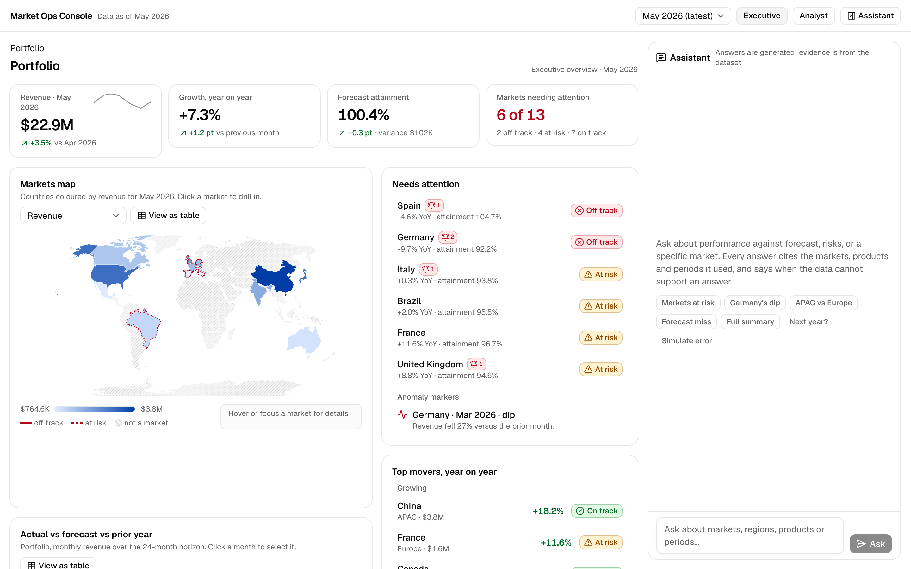
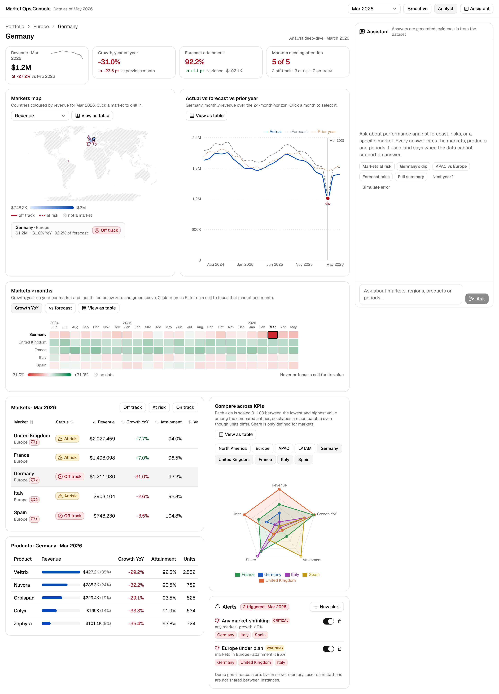
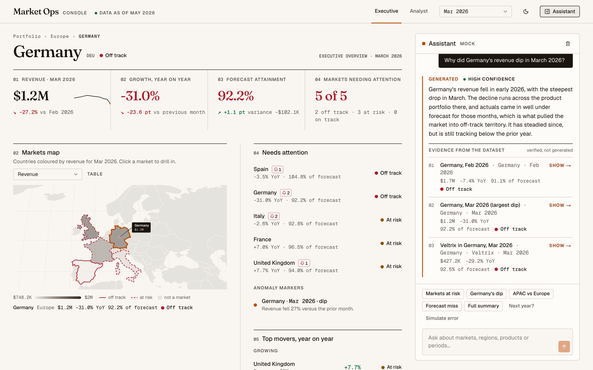
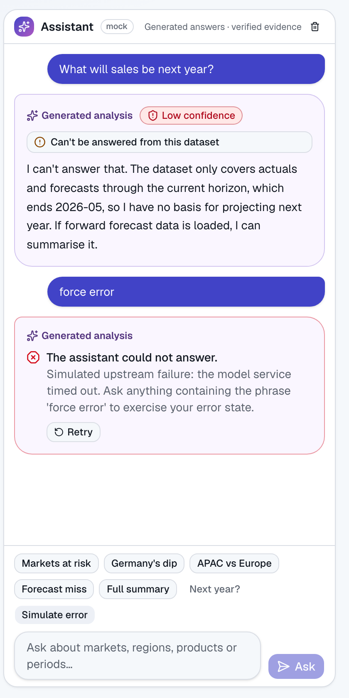
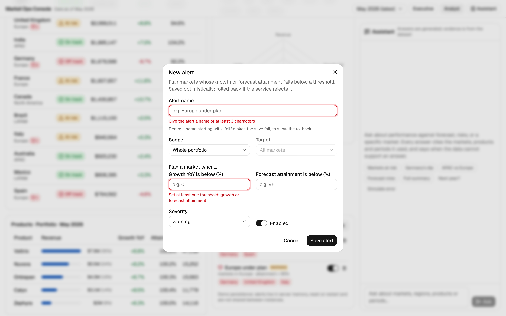
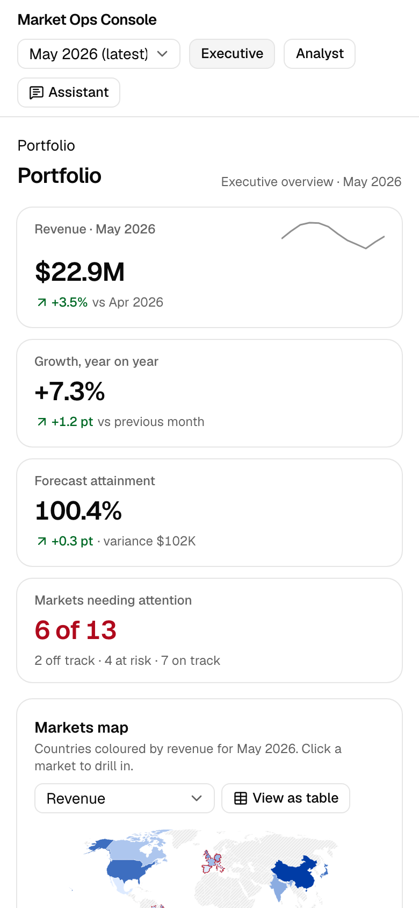
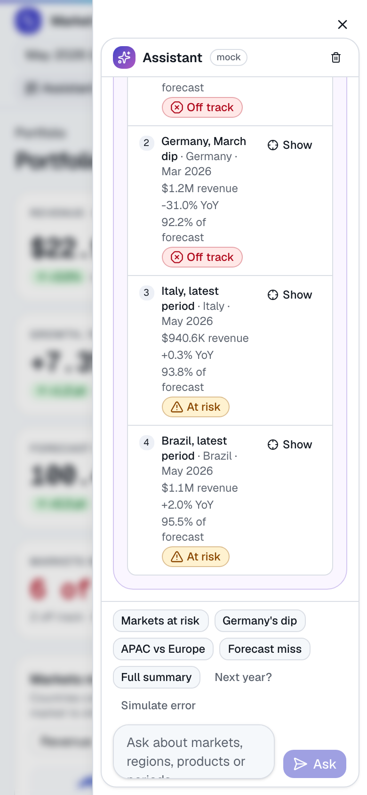
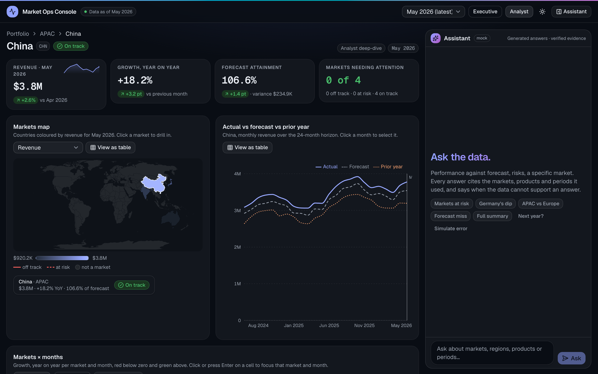

# Market Ops Console

A market operations console over a fixed, synthetic dataset: a dense analytical dashboard (portfolio → region → market → product) and a streaming assistant that cites the data it used and says when it cannot answer.

**Live:** https://market-ops-console-two.vercel.app · **Source:** https://github.com/AlexPalaz/market-ops-console

Built for the Front-End Engineer take-home. The AI is faked on purpose, exactly as the brief asks: the assistant streams canned answers from `fixtures.json` through the documented SSE contract. Everything the user can verify (numbers, status, evidence) is computed from `data.json`; everything generated is labelled as such.



## Contents

- [What it does](#what-it-does)
- [Quick start](#quick-start)
- [Architecture](#architecture)
- [Technical decisions](#technical-decisions)
- [Trustworthy AI UX](#trustworthy-ai-ux)
- [Data visualisation](#data-visualisation)
- [Accessibility](#accessibility)
- [Testing](#testing)
- [Performance](#performance)
- [Productionising](#productionising)
- [AI-assisted development workflow](#ai-assisted-development-workflow)
- [Trade-offs and known limitations](#trade-offs-and-known-limitations)
- [What I'd do next](#what-id-do-next)
- [Requirements checklist](#requirements-checklist)
- [Notes on the dataset](#notes-on-the-dataset)
- [Screenshots](#screenshots)
- [Video walkthrough](#video-walkthrough)

## What it does

**Dashboard**

- Drill through Portfolio → Region → Market → Product with a breadcrumb; the whole state lives in the URL, so any view is a shareable link and back/forward walks the drill path.
- Headline KPIs (revenue, YoY growth, forecast attainment, markets needing attention) with month-on-month deltas and a 12-month sparkline.
- Choropleth map coloured by a chosen KPI; click or press Enter on a country to drill in.
- Actual vs forecast vs prior-year time series with the selected month marked and anomaly markers from the dataset; click a month to select it everywhere.
- Markets × months heat map on a diverging scale (YoY growth, or variance vs forecast); arrow keys move between cells.
- Radar comparison of regions or markets across KPIs, min-max normalised with the raw values one hover away.
- Dense, sortable, filterable markets table and a product breakdown.
- Two audiences: **Executive** (health, risks, movers, few numbers) and **Analyst** (every metric, every drill path, dense tables), built from the same selectors and components.
- Light and dark themes (system default, toggle in the header); every chart colour is a token, so both themes are first-class.
- Alert configurator: a schema-validated form that flags markets below a growth or attainment threshold, saved optimistically with rollback on failure; triggered alerts show up on the markets themselves.

**Assistant**

- Streams token by token over Server-Sent Events, with an explicit generating state, Stop, and a partial answer kept when stopped.
- Every answer carries its evidence: citations resolved against the dataset, each with the verified figures and a "Show" that focuses the dashboard on that market/region/product and period.
- Confidence shown at the three documented levels, abstention when the data can't support an answer, an error state with retry.
- Generated prose and verified data are visually and structurally separate.

## Quick start

Requires Node 20+ and npm.

```bash
npm install
npm run dev          # http://localhost:3000
```

```bash
npm run typecheck    # tsc --noEmit
npm run lint         # eslint
npm run format:check # prettier
npm test             # vitest (unit, component, integration)
npm run build        # production build
npm run check        # all of the above in sequence
npm run e2e          # playwright: builds, starts on :3200, runs E2E + axe
```

First E2E run on a machine: `npx playwright install chromium`.

No environment variables are required. `NEXT_PUBLIC_VITALS_ENDPOINT` (see `.env.example`) optionally points the web-vitals reporter at a collector.

## Architecture

### Folder structure

```
src/
  app/                      Next.js App Router: layout, page, providers, error boundary,
    api/chat/route.ts       the starter pack's reference SSE handler, verbatim
    api/alerts/             mock alert persistence (in-memory)
  data/                     data.json + fixtures.json (verbatim), validated once with Zod;
                            DataProvider gives components the read-optimised index
  domain/                   pure TypeScript, no React, fully unit-tested
    types.ts  schemas.ts    domain types + Zod schemas for data, fixtures, SSE events
    dataIndex.ts            lookup maps + referential-integrity checks
    selectors/              aggregation, KPIs, movers, time series, heat map, radar,
                            citations, scope/breadcrumbs, alert evaluation
    format.ts               Intl formatters (currency, compact numbers, %, periods)
  features/
    dashboard/              state/selection.ts (URL schema), hooks/useDashboardSelection,
                            charts/ (map, time series, heat map, radar), components/
    assistant/              streaming/ (SSE parser, stream client), store/ (Zustand),
                            hooks/useChatStream, components/
    alerts/                 schemas/, server/ (mock store), hooks/ (TanStack Query), components/
  components/ui/            shadcn/ui primitives (Radix)
  components/shared/        ChartFrame, StatusBadge, Sparkline, ErrorBoundary
  lib/                      metric metadata + colour scales, ISO mapping, cn
  test/                     test setup, providers wrapper, SSE mock
e2e/                        Playwright specs (happy path, states, keyboard, a11y)
```

### Data flow

```
data.json ──Zod──▶ DataIndex ──▶ pure selectors ──▶ components
                                      ▲                  │
URL (?view&region&market&product&period&metric&compare)  │  one selection model
   ▲                                                     │
   └── useDashboardSelection ◀── map / heat map / table / breadcrumb / citation "Show"

fixtures.json ──▶ /api/chat (SSE) ──▶ streamChat (fetch + TextDecoder + SSE parser + Zod)
                                           │ events
                                           ▼
                                    chat store (Zustand) ──▶ AssistantPanel
                                           │ citations
                                           ▼
                                  resolveCitation(dataIndex) ──▶ Evidence panel ──▶ URL

/api/alerts (in-memory) ◀──▶ TanStack Query (optimistic) ──▶ AlertsPanel, badges
                                                              evaluateAlerts(dataIndex)
```

### State ownership

| Kind                                                       | Where                                                                    | Why                                                                                                                                                                                            |
| ---------------------------------------------------------- | ------------------------------------------------------------------------ | ---------------------------------------------------------------------------------------------------------------------------------------------------------------------------------------------- |
| Canonical dataset                                          | Static import, validated at module load, exposed through `DataProvider`  | It ships with the app and never changes at runtime; wrapping an import in a fetching library would be theatre. Tests inject a different index through the same provider.                       |
| Shareable selection (view, scope, period, metric, compare) | URL search params via `nuqs`; `useDashboardSelection` is the only writer | Deep links, refresh and back/forward come for free; nothing mirrors it into a store, so there is one source of truth. Drills and period changes `push` history; view/metric/compare `replace`. |
| Chat session                                               | Zustand store                                                            | Per-session, not shareable, updated at token rate. Only the assistant panel subscribes, so the dashboard never re-renders while text streams.                                                  |
| Alerts (server state)                                      | TanStack Query (`["alerts"]`)                                            | Fetched, cached, mutated with optimistic updates and rollback.                                                                                                                                 |
| Derived values                                             | Pure selectors in `domain/selectors`, memoised in components             | KPIs, rankings, matrices and comparisons are computed from the series on demand instead of stored.                                                                                             |
| Ephemeral UI                                               | Local `useState`                                                         | Hover, sort order, status filter, table toggle, panel open.                                                                                                                                    |

### Streaming

`/api/chat` is the starter pack's reference handler, unchanged. The client side is three small pieces:

1. `sseParser.ts`: an incremental parser. It buffers text and splits on the blank line that ends an event, so events split across `read()` calls or packed several to a chunk are handled identically. Comments and non-`data` fields are ignored per the spec.
2. `streamChat.ts`: `fetch` + `ReadableStream` + `TextDecoder` with `stream: true`. Every payload is validated with the `streamEventSchema` discriminated union; anything outside the contract is a typed `malformed` error. Reads are raced against the `AbortSignal`, so Stop resolves immediately rather than after the next chunk. A stream that closes without `done` or `error` is an `incomplete` error.
3. `useChatStream.ts`: owns the `AbortController` and a request id. Tokens are buffered and flushed once per animation frame. Events for a request that is no longer active (stopped or superseded) are dropped, so a late token can never overwrite a stopped answer.

### Selectors worth knowing

- `scopeKpis(index, scope, period)` sums the series for the scope and derives growth and attainment as ratios of the sums. No percentage is ever averaged.
- `heatmapMatrix` returns a symmetric bound so the diverging scale is centred on zero.
- `radarData` min-max normalises per axis over the compared set and keeps the raw values and extents for the tooltip and the table.
- `resolveCitation` maps a citation onto the dataset and reports ids it could not match rather than dropping them.
- `evaluateAlerts` returns hits by market and by alert for a period.

## Design

A restrained, data-dense console with one accent. Cool off-white canvas with a faint indigo glow and white cards with a hairline ring and a soft shadow for depth; in dark mode the same tokens flip to deep slate surfaces. Indigo is the only brand colour: primary actions, selection, the actual-revenue line, the focused row. Status colours (green / amber / red) are reserved for meaning and always paired with an icon and a label. Figures are set in Geist Mono with tabular numerals so columns line up and KPIs read as instruments; labels are small uppercase eyebrows. Generated text lives on a violet-tinted surface so it can never be mistaken for a dataset figure. Every colour, radius and shadow is a CSS variable in `globals.css`; nothing is hard-coded in components.

## Technical decisions

| Area                 | Chosen                                                        | Considered                                  | Why                                                                                                                                                                                                                                                             |
| -------------------- | ------------------------------------------------------------- | ------------------------------------------- | --------------------------------------------------------------------------------------------------------------------------------------------------------------------------------------------------------------------------------------------------------------- |
| Framework            | Next.js 16 App Router, React 19, TypeScript strict            | Remix, TanStack Start, Vite SPA             | Required stack family; server-rendered shell, route handlers for the mock APIs, trivial deploy. Cache Components is off because the reference route exports `runtime = "nodejs"`, which it does not support, and a single URL-driven page gains little from it. |
| Styling / components | Tailwind 4 + shadcn/ui on Radix                               | MUI, Chakra, hand-rolled                    | Tokens live in CSS variables (`@theme`) and the design-system layer is code I own; Radix gives accessible primitives (dialog, select, switch, tooltip) without a runtime theme engine.                                                                          |
| URL state            | `nuqs`                                                        | `useSearchParams` + hand-written parsers    | Typed parsers, batching, history control, a testing adapter. Dataset validation sits on top in `normalizeSelection`.                                                                                                                                            |
| Server state         | TanStack Query (alerts only)                                  | SWR, RTK Query                              | Optimistic update/rollback is a first-class pattern; scoped to the only thing that is actually fetched.                                                                                                                                                         |
| Client state         | Zustand (chat only)                                           | Context + reducer, Jotai                    | Token-rate updates outside React's render tree, selector-based subscriptions, trivial to test.                                                                                                                                                                  |
| Charts               | Recharts 3 (time series, radar); custom SVG (heat map, map)   | Visx, Nivo, ECharts, D3 everywhere          | Recharts covers the standard charts with little code; Recharts has no heat map or map, and custom SVG gives full control over keyboard and ARIA where it matters most.                                                                                          |
| Map                  | `d3-geo` + `topojson-client` + `world-atlas` 110m, custom SVG | react-simple-maps, MapLibre/Leaflet, Mapbox | No tile server, no WebGL, no unmaintained React wrapper; 13 countries are focusable buttons; ~40 KB gzipped, loaded lazily.                                                                                                                                     |
| Forms                | React Hook Form + Zod 4                                       | Formik, TanStack Form                       | Required; `zodResolver` with input/output types keeps the form values and the API payload typed separately.                                                                                                                                                     |
| Tests                | Vitest + Testing Library; Playwright + axe                    | Jest, Cypress                               | Fast unit loop; E2E on the production build with accessibility audits in the same run.                                                                                                                                                                          |
| Formatting           | `Intl.NumberFormat` / `Intl.DateTimeFormat`, fixed `en-US`    | per-user locale                             | A shared link must show the same figures to everyone; locale is a parameter in `format.ts` for when that becomes a preference.                                                                                                                                  |

> **Candidate's note (technical decisions).**
>
> _On the framework._ Next.js is used here as a meta-framework, not for its rendering model: one client-driven page, three route handlers, fonts, lazy loading and a zero-config deploy. For a single page whose shareable state lives in the URL, TanStack Start would have fit the problem better, with typed search params on the route and server functions for the mock API. I chose Next on risk, not on elegance: the brief asks for a stack that can be productionised and taken to an MVP with real users, and Next 16 has years of production behind it, a hiring pool, an ecosystem (shadcn/ui, `next/font`, Vercel) that documents it first, and the starter pack's reference route runs in it unchanged. I know what I gave up and I would make the same call for a team.
>
> _On state._ Zustand over Redux because the shared, shareable state of this app lives in the URL. What is left for a store is two small, ephemeral things: the chat session and the hover shared between charts. Two independent stores created where they are used, with selector-based subscriptions, beat one global store split into slices that would have had nothing global to hold. Redux Toolkit removed most of Redux's boilerplate; it did not remove the need for a reason to centralise.
>
> _What I kept simple on purpose._ The dataset is imported and validated at boot rather than fetched: the brief provides a fixed JSON, and a fake API would have been theatre. Alerts live in server memory with simulated latency and a deterministic failure, because the brief asks for an optimistic update with rollback, not for persistence; the limitation is stated in the UI. Formatting is pinned to `en-US` so a shared link shows the same figures to everyone. No Storybook: the stories would have documented Radix; the budget went to component tests and E2E with axe. No Markdown in the assistant: plain text removes a whole class of injection risk and the contract carries no formatting. Every one of these has a clear seam in the code, so replacing it does not touch the rest.
>
> _Libraries versus my own code._ I reach for a library when it is widely used and covers the edge cases I would otherwise rediscover one bug at a time: Recharts for the time series and the radar, Radix for dialogs and selects, Zod, TanStack Query, d3-geo for projections. I write the code myself only when no suitable library exists or when control of the DOM is the requirement. The map and the heat map are hand-written SVG for both reasons: Recharts has neither, the React map libraries were heavy or unmaintained on React 19, and those two charts carry the strongest keyboard and ARIA requirements in the app.

## Trustworthy AI UX

- **Generated vs verified.** Generated prose sits on its own surface (`--ai-surface`, `--ai-border`) under a "Generated analysis" label. The evidence block below it is a card on the data surface titled "Evidence from the dataset · verified figures, not generated". The two never share a container.
- **Citations.** The `done` event's citations are resolved against `data.json`: label, scope, period, and the recomputed revenue, YoY growth, attainment and status for exactly that scope and period. Ids that don't exist are reported in place ("Could not match …") rather than hidden. "Show" calls `focus(scope, period)` on the selection model, so the dashboard drills to the cited entity and month in one history entry.
- **Confidence.** Only the three documented levels, as a labelled badge with an icon. No percentage is invented. `low_confidence` answers get a "Directional only" callout; `abstain` gets "Can't be answered from this dataset" and no evidence block.
- **States.** Generating (spinner, caret, Stop button), stopped (partial answer kept, labelled), error (contract `error` event or transport failure, with Retry re-asking the same question), done.
- **Safe rendering.** Model output is rendered as plain text with `white-space: pre-wrap`. There is no HTML or Markdown path, so there is nothing to sanitise. A test asserts that `` in the text stays text.
- **Screen readers.** One polite live region announces "Generating", "Answer ready, high confidence, 3 citations", "Generation stopped" and errors. Tokens are never announced.

## Data visualisation

| Chart          | Encoding                                                                                                                                                                                           | Accessible equivalent                                                                                                                                 |
| -------------- | -------------------------------------------------------------------------------------------------------------------------------------------------------------------------------------------------- | ----------------------------------------------------------------------------------------------------------------------------------------------------- |
| Choropleth map | Fill = selected KPI (sequential for revenue/share, diverging around 0 for growth and around 100 for attainment); stroke = status (solid red off-track, dashed red at-risk); hatched = not a market | Each market is `role="button"` with a label like "Germany, revenue $1.7M, off track"; Enter drills; a detail strip echoes hover/focus; a ranked table |
| Time series    | Three lines (solid actual, dashed forecast, dotted prior year), selected month as a reference line, anomaly dots                                                                                   | Full table with vs-forecast and YoY columns; summary sentence                                                                                         |
| Heat map       | Markets × months, diverging colour centred on 0, selected cell outlined                                                                                                                            | `role="grid"` with row/column headers, arrow-key navigation, Enter selects; full table                                                                |
| Radar          | One polygon per entity, axes scaled 0–100                                                                                                                                                          | Table with raw values and the scaled value under each                                                                                                 |

Colour scales are built from design tokens with `color-mix()`, so they follow the theme and the legend gradient is the same CSS the cells use. Status is always icon + text + colour.

**Aggregation.** Region and portfolio figures are sums over the fact table. Growth and attainment at any level are ratios of those sums. Market share is synthetic in the dataset (the per-market values sum to 266%), so it is shown only per market and hidden when a product filter is active.

**Normalisation.** The radar scales each axis between the minimum and maximum of the entities being compared. The chart says so in its description, and the table shows both numbers.

**Coordination.** Map, heat map, table, breadcrumb, movers, risk list and citations all write through `useDashboardSelection`; period changes come from the header select, the time series, the heat map or a citation. High-frequency interactions (hover, focus) stay local; only commits touch the URL.

## Accessibility

Target: WCAG 2.1 AA. Verified with axe (serious and critical, WCAG 2.x A/AA tags) in the E2E suite on the executive view, the drilled analyst view and a finished answer, plus keyboard and reduced-motion checks.

Implemented:

- Semantic landmarks, skip link, `h1` per view, labelled groups for every chart (`aria-labelledby` / `aria-describedby`).
- Keyboard: map countries and heat-map cells are focusable with visible focus rings; arrow keys in the grid; dialogs and sheets trap focus (Radix); all actions are buttons.
- Every chart has a "View as table" toggle and the table is also available to assistive tech while the chart is shown; charts are never `aria-hidden`.
- Status never relies on colour alone; status and muted text tokens were darkened to pass 4.5:1 on their backgrounds.
- Forms: labels, `aria-invalid`, `aria-describedby` on each error, `role="alert"` on messages.
- `prefers-reduced-motion` disables all animations and transitions, including Recharts.
- Tabular figures everywhere; the mobile layout has no horizontal scroll at 390 px.

Not covered yet: a screen-reader walkthrough with VoiceOver/NVDA (only automated checks and keyboard), high-contrast mode, RTL, and an explicit colour-blind simulation of the diverging palette.

## Testing

| Layer               | Tool                               | What                                                                                                                                                                                                                                                                                                                                 |
| ------------------- | ---------------------------------- | ------------------------------------------------------------------------------------------------------------------------------------------------------------------------------------------------------------------------------------------------------------------------------------------------------------------------------------ |
| Unit (40)           | Vitest                             | Dataset and contract schemas, aggregation (ratios, zero denominators), movers, time series, heat map, radar normalisation, citation resolution, scope rules, formatters, URL parse/serialise, SSE parser (split/merged/CRLF/malformed), stream client (abort, incomplete, HTTP), chat store (stale ids), alert schema and evaluation |
| Component (c. 30)   | Vitest + Testing Library           | ChartFrame toggle and SR table, KPI tiles, markets table sort/filter/select, selection hook through the nuqs testing adapter, answer states (streaming, stopped, abstain, low confidence, error), plain-text rendering, alert form validation and coercion                                                                           |
| Integration (c. 20) | Vitest + Testing Library           | Assistant panel with a mocked SSE fetch (stream, stop keeps partial, error event, HTTP failure), citation → URL → dashboard scope, optimistic create/toggle with rollback and toasts                                                                                                                                                 |
| E2E (10)            | Playwright on the production build | Drill → ask → stream → citation → dashboard → back; stop/abstain/error; deep link, heat-map and map keyboard; alert validation + rollback; phone width with the assistant sheet; axe audits; reduced motion                                                                                                                          |

Run: `npm test` (91 tests, ~3 s) and `npm run e2e` (~20 s after the build).

Deliberately skipped: visual regression, Recharts internals (treated as a dependency; the data fed to them is tested), load tests on the mock APIs, and tests of the reference route itself (it is the starter pack's code).

> **Candidate's note (testing).**
>
> _What is worth testing here._ In this order: the pure logic first, because a wrong sum invalidates every chart that reads it, and selectors are the cheapest thing to test exhaustively. Then the boundaries, where dirty input arrives: the SSE parser against chunks split and merged in every way, the Zod schemas for the dataset and the stream, the URL parsing and the rules that keep a selection coherent. Then the flows that touch the user's trust: stop keeps the partial answer and ignores late tokens, a failed save rolls back and says so, a citation really moves the dashboard to the cited market and month. Last, one end-to-end happy path on the production build plus axe in both themes, because that is the only test that exercises the real bundle, real hydration and real keyboard. The pyramid is deliberately bottom-heavy: 40 unit tests run in a second and catch most regressions; the 10 E2E tests catch the rest.
>
> _What I deliberately skipped._ Pixel tests on charts: they fail on every font or antialiasing change and prove nothing about correctness, which the data tables and the selector tests already cover. Testing Recharts or Radix internals: they are dependencies, I test what I feed them and what the user can reach. Chasing 100% coverage: the uncovered lines are wiring, and a coverage number is not a quality number. Load tests on an in-memory mock. Tests of the reference route itself, which is the starter pack's code.
>
> _What I would add as the product grows._ Visual regression on whole screens in known states, compared as images, to catch layout and theme regressions that no unit test sees. Contract tests on the SSE endpoint once a real model sits behind it. A performance budget in CI (Lighthouse CI on bundle size, LCP, INP) so the numbers in this README stop being a snapshot and become a gate.

## Performance

Measured on the production build (`next build && next start`), Lighthouse 12 desktop preset, deep link `?region=eu&market=de&period=2026-03`:

| Metric                                       | Value          |
| -------------------------------------------- | -------------- |
| Performance / Accessibility / Best practices | 99 / 100 / 100 |
| First Contentful Paint                       | 0.2 s          |
| Largest Contentful Paint                     | 1.0 s          |
| Total Blocking Time                          | 0 ms           |
| Cumulative Layout Shift                      | 0              |
| Initial JavaScript (gzipped)                 | 368 KB         |

What was done:

- The page is rendered on demand (`dynamic = "force-dynamic"`) so a deep link comes back already drilled in; the static alternative served a Suspense fallback that the client then replaced.
- Recharts (~165 KB gzipped) and the map (d3-geo + topology) are loaded with `next/dynamic` after hydration; tiles, tables and the heat map render first. That took the initial bundle from 479 KB to 368 KB gzipped.
- Streaming never re-renders the dashboard: chat state is in a separate store and tokens are flushed once per frame.
- Expensive selectors are memoised on the selection; the dataset index is built once.
- Chart areas have fixed heights and skeletons of the same size, so switching chart/table or loading causes no layout shift.

Remaining: the dataset (~40 KB gzipped) ships in the bundle; React + Next runtime + Radix make up most of the rest. A code-split per view (executive vs analyst) would shave a little more.

## Productionising

- **Core Web Vitals.** Reported by `src/app/web-vitals.tsx` through `useReportWebVitals`: console in development, `navigator.sendBeacon` to `NEXT_PUBLIC_VITALS_ENDPOINT` when set. Budget to enforce in CI next: LCP < 2.5 s, INP < 200 ms, CLS < 0.1, initial JS < 400 KB gzipped.
- **Error tracking.** `ErrorBoundary` isolates each chart, the dashboard and the assistant with a reset; `app/error.tsx` catches the route. `onError` on the boundary is the hook for Sentry or similar; nothing is wired to a vendor.
- **Resilience.** Zod at every boundary (dataset at boot, SSE events, API payloads, form input); typed stream errors with user-facing messages; abort on unmount; stale-event guards; optimistic rollback; invalid URL params normalised instead of crashing.
- **Security.** Model output is text-only; no `dangerouslySetInnerHTML` anywhere; no user content reaches the URL; API bodies are validated and bounded.
- **Build, serve, cache.** `next build` produces one dynamic page and three route handlers. The page is served per request (cheap: one render of a bundled dataset); static assets are content-hashed and immutable. `/api/alerts` sends `Cache-Control: no-store`. The chat stream is `no-cache, no-transform` as the reference route sets it.
- **CI/CD.** `.github/workflows/ci.yml`: typecheck, lint, format check, unit tests, build; then Playwright E2E + axe on the built app with Chromium. Deploy target is Vercel (zero-config for App Router); the same `npm run build` runs anywhere Node 20 runs.
- **Persistence.** Alerts live in the server process's memory on purpose. On a serverless platform each instance has its own list and a cold start resets it. The UI says so. A real backend would replace `features/alerts/server/store.ts` and nothing else.

## AI-assisted development workflow

This project was built in a pair-programming session with Claude Code (Claude Fable 5.1), driven from a written specification and reviewed phase by phase.

What actually happened:

1. **Discovery before code.** The assignment document and the starter pack were read and the dataset was inspected numerically (schema, id integrity, how the precomputed KPIs relate to the series) before any file was created. That is where the two data findings in [Notes on the dataset](#notes-on-the-dataset) came from.
2. **A plan I approved.** Claude Code's plan mode produced a requirements checklist, an architecture, a URL schema, a risk list and a seven-phase implementation order. I answered four decisions (project location, package manager, fourth chart, Next version) and approved the plan before implementation.
3. **One phase at a time, with gates.** Foundation → dashboard → assistant → alerts → quality → delivery. Each phase ended with `tsc`, ESLint, Vitest and `next build` green, a manual run in the browser (the assistant drove Chrome and checked the console, URLs and screenshots), a commit, and a written report; the next phase started only on my go.
4. **The starter pack as the source of truth.** `CONTRACT.md` fixed the streaming behaviour; `data.json` fixed every aggregation. The reference route is used unchanged. Nothing about the data, the events or the citations was invented.
5. **Tests found real bugs.** The accessibility and E2E suite surfaced an `aria-hidden` chart wrapper hiding focusable elements, 0-based grid indices, a duplicate input id between the desktop panel and the mobile sheet, contrast failures and a horizontal overflow at phone width. All were fixed in the same phase.

> **Candidate's note (AI-assisted development workflow).**
>
> _The loop I use._ I read the brief myself first. Then I give the specification to a general model (GPT) to extract the context, surface the constraints and propose candidate architectures. I compare the proposals, choose one, and have the model turn that choice into a master prompt: a written specification with the stack, the principles, the phases and the quality gates. That prompt goes to Claude Code, almost always in plan mode: discovery and a written plan first, my approval, then one phase at a time, and I verify each step before the next one starts. The starter pack files stayed the source of truth over the prompt throughout; where they disagreed, the files won.
>
> _What I let the tool decide._ File structure inside the architecture, the implementation of selectors and parsers, the tests, the rewrite of components against a design I had specified. The condition is that the architecture has been reviewed and agreed up front; within those lines the tool is faster than me and makes fewer typos.
>
> _What I always review myself._ The meaning of the data and every aggregation (it was a read of the series, not the tool, that showed Germany's March dip is invisible against a re-baselined forecast and decided the heat map's default metric). Anything that touches the user's trust in the assistant: what counts as evidence, how confidence is shown, what happens on stop and on error. Accessibility. What goes into the URL and what does not. Design direction. Diffs before commits, with a depth that depends on the stage: everything in the foundation phase, the risky areas once the patterns are established and the tests carry the rest.
>
> _How the output stays at my standard._ Gates that do not negotiate: typecheck, lint, unit tests and a production build at the end of every phase, the E2E suite with axe before anything is called done, CI on every push. Screenshots at each checkpoint, in both themes and at phone width, because a green suite says nothing about whether the page looks designed. A commit per phase with a message that states what was done and what was found.
>
> _Don'ts, and one example._ I do not delegate the question "is this finished": a passing test is evidence, not a verdict. I do not accept a change I cannot explain. And I do not trust a chain of commands to stop on its own. During delivery a shell edit broke a JSX tag, the chain that followed did not halt on the failed build, and a broken commit reached GitHub; CI went red and Vercel refused the build, so production was never touched. The fix was two commits later, with every step gated on the previous one. That is the shape of the risk with these tools: not wrong code, which tests catch, but a process that keeps going when it should have stopped. The safety nets (CI, the deploy's own build) exist for exactly that, and I keep them.

## Trade-offs and known limitations

- **Mock persistence.** Alerts reset on restart and are not shared between instances (stated in the UI).
- **Dataset in the bundle.** Simplest correct option for a fixed dataset; a real product would fetch it through TanStack Query with pagination for the series.
- **Single locale.** `en-US` formatting everywhere, by design; see Technical decisions.
- **Assistant context.** The assistant does not know what the dashboard shows (stretch goal not taken). Suggested questions are static.
- **Radar axes.** Five fixed axes; market share is undefined for regions, so that axis is empty for them.
- **Map detail.** The 110 m topology is intentionally coarse (small file); small territories are omitted.
- **No Storybook, no visual regression.** The design-system layer is shadcn components plus tokens; stories would mostly document Radix.

## What I'd do next

1. Assistant aware of the current selection (prefix the question with the drill context; fixtures keyed on it).
2. Command palette (⌘K) to jump to any market or product; the selection API already supports it.
3. Virtualised series table in the analyst view and a growth-vs-share bubble chart with brushing.
4. A real alert store (Postgres via a route handler), with the same optimistic hooks.
5. Per-view code splitting and a CI performance budget (Lighthouse CI).
6. Screen-reader walkthrough and a colour-blind check of the diverging palette.

> **Candidate's note (with more time).**
>
> _Three priorities, in order._ First, the things that stand between this build and real users: a real store behind the alert hooks (the optimistic layer does not change), the dataset served through a query with the series paginated, and a performance budget in CI so the figures in this README become a gate rather than a snapshot. Second, the assistant aware of the current selection: the drill context prefixed to the question and the suggested questions generated from what the dashboard shows. It is the stretch goal with the highest value per hour, because it closes the loop between the two surfaces instead of leaving the user to carry context from one to the other. Third, the command palette, because once there are more than a dozen markets and products, "jump to" beats "drill to".
>
> _One thing I would set up differently._ I would put the dataset behind TanStack Query from day one, served by a route handler, instead of importing it into the bundle. The import was the right call for a fixed JSON and it keeps the tests deterministic, but it leaves the data path in a shape that production will not have: no loading or error state for the data itself, no cache lifetime, no way to page the series as it grows beyond 24 months and 13 markets. Starting with the query would have cost a loading skeleton and a mock handler on day one, removed 40 KB from the initial bundle, and made the later move to a real API a change of URL rather than a change of architecture. Everything downstream, the selectors and the charts, already reads from an index and would not have noticed.

## Requirements checklist

| Requirement                                         | Where                                                            |
| --------------------------------------------------- | ---------------------------------------------------------------- |
| React 18+ with TypeScript, App Router, no `any`     | Next 16 / React 19, `strict: true`; ESLint passes with no `any`  |
| Typed data contract and streaming events            | `domain/types.ts`, `domain/schemas.ts`                           |
| Streaming token-by-token, in-progress state, stop   | `features/assistant/streaming`, `useChatStream`, `AnswerMessage` |
| Citations tied to markets/products/periods          | `resolveCitation`, `EvidencePanel`, "Show" → `focus()`           |
| Confidence and abstention, honest and legible       | `ConfidenceBadge`, abstain/low-confidence callouts               |
| AI vs authoritative distinction                     | AI surface vs evidence card; labels; separate containers         |
| Drill-down without losing context                   | Breadcrumb, URL scope, `scopeBreadcrumbs`                        |
| Portfolio health at a glance                        | `KpiTiles`, `TopMovers`, `RiskList`                              |
| Choropleth with click-to-drill                      | `MarketsMap`                                                     |
| Radar comparison                                    | `RadarCompareChart`                                              |
| Time series actual/forecast/prior-year              | `TimeSeriesChart`                                                |
| One advanced chart                                  | `HeatmapChart` (markets × periods, diverging)                    |
| Executive vs analyst views                          | `ExecView`, `AnalystView`, `view` param                          |
| Coordinated views, URL state, back/forward          | `useDashboardSelection`, `state/selection.ts`                    |
| Accessible charts, no colour-only signals           | `ChartFrame` tables, ARIA on map/grid, status badges, axe in E2E |
| Multi-market formatting                             | `domain/format.ts`                                               |
| Schema-validated form, optimistic update + rollback | `AlertForm`, `useAlerts`                                         |
| Design system / tokens                              | `globals.css` `@theme`, shadcn components                        |
| Server vs client state split                        | See [State ownership](#state-ownership)                          |
| Component + integration tests, one E2E happy path   | 91 Vitest tests, 9 Playwright tests                              |
| README sections requested by the brief              | This file                                                        |
| Live deployment                                     | https://market-ops-console-two.vercel.app                        |

## Notes on the dataset

Two things worth knowing if you read the numbers closely:

- **Precomputed KPIs vs recomputed.** `markets[].kpis` are precomputed for May 2026. Revenue and growth match the sums over `series` exactly; forecast attainment differs by up to 0.2 points because of rounding (Germany: 92.0% precomputed, 92.2% from the sums). The console always recomputes from the series so every chart agrees with every other chart; `status`, `sharePct` and `anomalies` are read from the precomputed block because they cannot be derived.
- **Germany's March 2026 dip is invisible against forecast.** Revenue fell 27% month on month and 31% year on year, but the forecast for that month was re-baselined downwards, so attainment stays at 92%, the same as neighbouring months. That is why the heat map defaults to YoY growth rather than variance vs forecast, with the latter one toggle away.

## Screenshots

|                                                                       |                                                                   |
| --------------------------------------------------------------------- | ----------------------------------------------------------------- |
|         |  |
|  |       |
|                    |      |
|                  |                                                                   |

## Video walkthrough

[**docs/walkthrough/walkthrough.mp4**](docs/walkthrough/walkthrough.mp4) (3 min 52 s, 1080p) walks through both views, the assistant and the alerts, narrated by the candidate, with the narration also burned in as captions. [`walkthrough.srt`](docs/walkthrough/walkthrough.srt) is the narration as subtitles.

The video is generated, not screen-recorded: `scripts/walkthrough/record.mjs` drives the production build with Playwright, captures frames through the DevTools screencast and injects the captions and a cursor into the page; `scripts/walkthrough/encode.mjs` turns the frames into the MP4 and muxes the voice track.

```bash
npm run build && npm run start -- -p 3200
node scripts/walkthrough/record.mjs http://localhost:3200 /tmp/walkthrough
node scripts/walkthrough/encode.mjs /tmp/walkthrough docs/walkthrough/walkthrough.mp4 [voice.m4a]
```

## License

Starter pack data and reference route belong to the assignment authors. Everything else: MIT.
